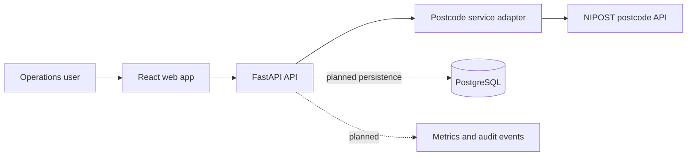

# Architecture

RouteSure starts as a modular monolith: a React/TypeScript client, a FastAPI service, a PostgreSQL database planned for persisted tenants and lookup history, and a provider adapter for NIPOST.

## Boundaries
- **Web:** presentation and client-side form validation only. Provider data is authoritative for lookup results.
- **API:** input validation, rate limiting, authentication, tenant scoping, error mapping, and audit policy.
- **Provider adapter:** isolates endpoint paths, headers, schemas, retries, timeouts, and provider-specific errors.
- **Database:** future storage for tenants, users, API credentials (hashed), address checks, and audit events.

## Trust boundaries
The NIPOST API key is server-side only. Do not expose it in Vite variables or client bundles. Treat provider responses as external input and validate them before persistence or display.

## Production hardening
Implement auth, tenant isolation, migrations, rate limits, structured redacted logs, provider contract tests, CI, secrets management, backup/restore, and operational alerts before production use.

See `diagrams/system-architecture.mmd` for the source diagram.
